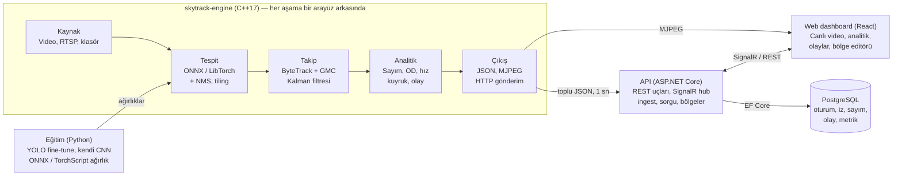
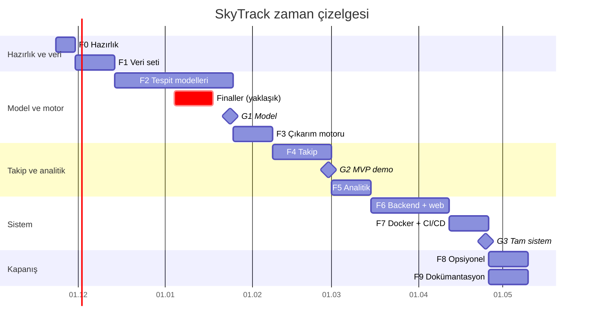

# Drone Tabanlı Kavşak Trafik Analitiği — Proje Roadmap'i

*Hazırlanma tarihi: 19 Kasım 2026 · Yavuz Gümüş*

## Projeye genel bakış

**Çalışma adı: SkyTrack** — drone görüntüsünden kavşakta araçları gerçek zamanlı tespit eden, takip eden ve trafik analitiği üreten C++ tabanlı bir sistem. Toplam süre yaklaşık 24 hafta (haftada 12–15 saat), yani Haziran 2027 mezuniyetinden önce biter; istersen bitirme projesine de dönüştürülebilir.

Orijinal proje ([selorito/vehicle-detection-cpp](https://github.com/selorito/vehicle-detection-cpp)) tek bir görüntüde araç tespiti yapıyor: LibTorch ile sıfırdan yazılmış 400K parametreli bir CNN, AU-AIR + UAVDT verisi, Tkinter arayüz ve PostgreSQL kayıt. Kendi README'sine göre mAP@0.5 değeri 0.144 ve takip, hız, video desteği yok. SkyTrack bu çekirdeği alıp üç yönde büyütüyor: **video ve takip**, **trafik mühendisliği analitikleri**, **üretim kalitesinde yazılım (web, Docker, CI/CD, test)**.

| Alan | Orijinal proje | SkyTrack (senin projen) |
| --- | --- | --- |
| Girdi | Tek görüntü | Video dosyası, RTSP canlı yayın, görüntü klasörü |
| Model | Sıfırdan CNN, tek ölçek (13×13), 2 sabit anchor | Sıfırdan CNN v3 (residual blok, 2 ölçekli head, k-means anchor, CIoU) + fine-tune edilmiş YOLO baseline; ikisi aynı test setinde kıyaslanır |
| Çıkarım | LibTorch, görüntü başına tek forward | ONNX Runtime + LibTorch arka uçları, FP16/INT8, çok iş parçacıklı pipeline, FPS ölçümü |
| Takip | Yok | Kalman + Hungarian ile SORT, ardından ByteTrack; drone kamera hareketi telafisi |
| Analitik | Araç sayısı, yoğunluk skoru | Çizgi geçiş sayımı, dönüş hareketi (OD) matrisi, homografi ile hız (km/sa), kuyruk uzunluğu, ısı haritası, olay alarmı |
| Arayüz | Tkinter masaüstü | Web dashboard: canlı video, grafikler, olay akışı, bölge editörü |
| Backend | Python'dan doğrudan DB'ye yazma | ASP.NET Core Web API + SignalR, PostgreSQL |
| Veri | AU-AIR + UAVDT, karma bölünme | UAVDT + VisDrone (DET ve MOT), sekans bazında bölünme |
| Değerlendirme | mAP@0.5, ortalama IoU | mAP@0.5 ve mAP@0.5:0.95, MOTA/IDF1/HOTA, FPS, sayım doğruluğu |
| DevOps | Elle kurulum; ağırlıklar için "bana yazın" | Docker Compose, GitHub Actions, GHCR imajları, ağırlıklar GitHub Releases'ta |
| Test | Yok | GoogleTest ve xUnit birim testleri, örnek videoyla entegrasyon testi |

**Savunma sanayii bağlantısı:** Drone görüntüsünde küçük nesne tespiti ve hareketli kamerada çoklu nesne takibi, İHA'lardaki gözetleme ve hedef takip probleminin aynısı. C++, gerçek zamanlı pipeline ve edge cihaz optimizasyonu Baykar, ASELSAN ve TUSAŞ ilanlarında sık geçen becerilerle örtüşüyor.

**Kural:** Orijinal repodan kod kopyalama. Onu README'de ilham kaynağı olarak an; mimariyi ve kodu kendin yaz. Mülakatta her satırı savunabilmen projenin asıl değeri.

## Sistem mimarisi ve teknoloji yığını

Sistem beş parçadan oluşur: C++ çıkarım motoru (tespit, takip, analitik), ASP.NET Core API, PostgreSQL, React web arayüzü ve Python eğitim araçları. Motor sonuçları API'ye toplu JSON olarak gönderir; API veritabanına yazar ve SignalR ile tarayıcıya canlı iter. Canlı video motorun kendi MJPEG akışından gelir.



Web'den çizilen bölgeler API üzerinden motora döner ve motor yeniden başlamadan yükler; eğitim tarafı yalnızca model ağırlığı üretir.

**Tasarım ilkesi:** Motorun her aşaması bir arayüz (interface) arkasında dursun: `IFrameSource`, `IDetector`, `ITracker`, `IAnalyticsModule`, `IEventSink`. Böylece kendi CNN'in ile YOLO'yu tek satır config değişikliğiyle değiştirebilirsin. Bu, OOP geçmişini mülakatta göstermenin en somut yolu.

| Katman | Seçim | Neden |
| --- | --- | --- |
| Dil ve derleme | C++17 (mümkünse C++20), CMake 3.22+, Ninja, vcpkg (manifest modu) | Bağımlılıkları `vcpkg.json` ile sabitlemek CI ve Docker'ı kolaylaştırır |
| Görüntü | OpenCV 4.x | Video okuma/yazma, ön işleme, homografi, ECC hizalama |
| Çıkarım | ONNX Runtime (CPU/CUDA), LibTorch | YOLO için ONNX; kendi modelin için LibTorch |
| Matematik | Eigen 3 | Kalman filtresi matrisleri |
| Yardımcılar | nlohmann/json, yaml-cpp, spdlog, cpp-httplib | Config, loglama, HTTP istemci ve MJPEG sunucusu |
| Test (C++) | GoogleTest, CTest | IoU, NMS, Hungarian, Kalman birim testleri |
| Eğitim | Python 3.11, Ultralytics, pycocotools, TrackEval; Kaggle/Colab GPU | Baseline eğitimi ve metriklerin bağımsız doğrulanması |
| API | ASP.NET Core 8 veya 10 (LTS), EF Core, SignalR, Serilog, xUnit | C# güçlü tarafın; SignalR gerçek zamanlı akışı çok kolaylaştırır |
| Veritabanı | PostgreSQL 16 (opsiyonel TimescaleDB) | Zaman serisi sorguları için uygun, zaten biliyorsun |
| Web | React + Vite + TypeScript, Recharts | Piyasada en çok istenen ön yüz; zaman kısıtlıysa Blazor yedek plan |
| DevOps | Docker, Docker Compose, GitHub Actions, GHCR | Tek komutla kurulum ve otomatik test |
| Ortam | Ubuntu 24.04 (Windows'taysan WSL2) | LibTorch ve vcpkg Linux'ta çok daha sorunsuz |

## Zaman çizelgesi

Plan 24 hafta sürüyor ve üç kontrol noktasına bağlı. 23 Kasım 2026'da başlarsan 14. haftada (Şubat sonu) paylaşılabilir bir video demosu, 22. haftada (Nisan sonu) tek komutla kalkan tam sistem olur. Ocak finalleri (yaklaşık 7–8. haftalar) model eğitimine denk getirildi: eğitimler Kaggle/Colab'da arka planda koşarken sen sınava çalışırsın. Sömestr tatili (10–11. haftalar) en yoğun kodlama dönemi.



| Faz | Haftalar | Tarih aralığı |
| --- | --- | --- |
| F0 Hazırlık | H1 | 23–29 Kasım 2026 |
| F1 Veri seti | H2–3 | 30 Kasım – 13 Aralık 2026 |
| F2 Tespit modelleri | H4–9 | 14 Aralık 2026 – 24 Ocak 2027 |
| F3 Çıkarım motoru | H10–11 | 25 Ocak – 7 Şubat 2027 |
| F4 Takip | H12–14 | 8–28 Şubat 2027 |
| F5 Analitik | H15–16 | 1–14 Mart 2027 |
| F6 Backend + web | H17–20 | 15 Mart – 11 Nisan 2027 |
| F7 Docker + CI/CD | H21–22 | 12–25 Nisan 2027 |
| F8 Opsiyonel | H23–24 | 26 Nisan – 9 Mayıs 2027 |
| F9 Dokümantasyon | H23–24 (F8 ile paralel) | 26 Nisan – 9 Mayıs 2027 |

F2'nin uzun olması bilinçli: eğitimler finallerde arka planda koşar. F8 opsiyonel.

- **G1, 9. hafta — Model kapısı:** Kendi modelin aynı test setinde mAP@0.5 ≥ 0.25 (orijinal 0.144) ve YOLO baseline ONNX olarak dışa aktarılmış. Hedefe ulaşamazsan ablation tablosuyla nedenini yaz ve devam et; proje YOLO ile de çalışır.
- **G2, 14. hafta — MVP:** Bir UAVDT videosunda ID'li takip, iz çizgileri ve çizgi geçiş sayımı. LinkedIn'de ilk paylaşım bu.
- **G3, 22. hafta — Sistem:** Temiz makinede `git clone` + `docker compose up` ile 10 dakikada çalışan dashboard, CI yeşil.

Docker ve CI ayrı bir faz gibi görünse de Faz 0'da başlar: her yeni modül ilk günden testli ve CI'da derleniyor olmalı.

## Faz 0 — Hazırlık ve ortam (1. hafta)

Hedef: Boş ama derlenen, CI'da yeşil yanan bir repo ve modern C++ ile Docker'ın temelleri. Bu faz atlanırsa sonraki her faz bağımlılık kurulumunda takılır.

**Öğreneceklerin:** Modern C++ (RAII, `unique_ptr`/`shared_ptr`, move semantics, lambda, `std::thread`, `mutex`, `condition_variable`), modern CMake (target tabanlı), vcpkg, Docker'ın temel kavramları (image, container, volume, Dockerfile, compose), GitHub Actions'ın işleyişi.

- [ ] Windows kullanıyorsan WSL2 + Ubuntu 24.04 kur; g++ 13, CMake, Ninja, Git kur.
- [ ] learncpp.com'da akıllı işaretçiler, move semantics ve lambda bölümlerini tekrar et; C#'tan farklı olan bellek yönetimini not al.
- [ ] vcpkg'yi manifest modunda kur; `vcpkg.json`'a `opencv4`, `nlohmann-json`, `spdlog`, `gtest`, `eigen3`, `yaml-cpp`, `cpp-httplib` ekle.
- [ ] İlk program: OpenCV ile bir video aç, kareleri göster, ekrana FPS yaz.
- [ ] Bir GoogleTest testi yaz (örnek: iki kutu arası IoU hesabı) ve `ctest` ile çalıştır.
- [ ] Docker'ın resmi "Get Started" eğitimini bitir; programa basit bir Dockerfile yaz.
- [ ] GitHub Actions'ta her push'ta derleyip testleri koşan ilk workflow'u kur (vcpkg önbelleğiyle).
- [ ] Repo kuralları: `main` korumalı, her iş bir branch + PR, Conventional Commits (`feat:`, `fix:`), GitHub Projects'te kanban tahtası.
- [ ] `.clang-format` ve `.editorconfig` ekle.

**Bitti sayılır:** `cmake --preset release && cmake --build` ile video oynatıcı derleniyor, IoU testi geçiyor, CI rozeti yeşil.

## Faz 1 — Veri seti (2–3. haftalar)

Hedef: Tek bir script ile tekrar üretilebilen, sekans bazında bölünmüş, 4 sınıflı bir drone araç veri seti. Orijinal projedeki düşük AP'nin bir nedeni 8 sınıfın bir kısmının çok seyrek olması (Bicycle 0.027, Trailer 0.029); sınıf sayısını azaltmak bunu doğrudan çözer.

| Veri seti | İçerik | Kullanım |
| --- | --- | --- |
| [UAVDT](https://arxiv.org/abs/1804.00518) | 100 video sekansı, yaklaşık 80.000 kare, 1080×540, 30 fps; sınıflar car, truck, bus; irtifa, hava ve kamera açısı etiketleri | Tespit eğitimi, MOT değerlendirmesi, demo videoları |
| [VisDrone2019-DET](https://docs.ultralytics.com/datasets/detect/visdrone) | 8.629 görüntü (6.471 train, 548 val, 1.610 test-dev), 10 sınıf | Tespit eğitimi, sınıf çeşitliliği |
| [VisDrone2019-MOT](https://github.com/VisDrone/VisDrone-Dataset) | ID etiketli video sekansları | Takip değerlendirmesi (Faz 4) |

**Hedef sınıflar (4):** `car` (VisDrone car + van), `truck`, `bus`, `motor`. Yaya, bisiklet ve tricycle sınıflarını bırak; proje araç odaklı. UAVDT'de motor yok, bu yüzden motor sınıfı yalnızca VisDrone'dan gelir; bunu README'de sınırlılık olarak yaz.

- [ ] İndirme ve dönüştürme için `scripts/prepare_data.py` yaz; ham veri repoya girmez, `.gitignore`'a ekle.
- [ ] Her iki veri setini **YOLO txt** ve **COCO json** formatına çevir. COCO json, pycocotools ile bağımsız mAP doğrulaması için gerekli.
- [ ] **Ignore region**'ları işle: iki veri setinde de çok küçük araçların bulunduğu alanlar etiketsiz bırakılmış. Bu alanları gri ile maskele, yoksa model doğru tespitleri yanlış pozitif sayılır diye öğrenir.
- [ ] **Sekans bazında böl:** Ardışık kareler neredeyse aynı. Kare bazında rastgele bölersen test seti eğitimin kopyası olur ve metrikler şişer. Train/val/test oranı yaklaşık 70/15/15 sekans olsun.
- [ ] UAVDT'de her 5. kareyi al (alt örnekleme); 30 fps'deki kareler tekrar ediyor ve eğitimi gereksiz yavaşlatır.
- [ ] EDA not defteri: sınıf dağılımı, kutu boyutu histogramı (piksel), görüntü başına nesne sayısı, irtifaya göre ortalama kutu boyutu. Bu grafikler README'ye girecek.
- [ ] Kutu genişlik/yükseklikleri üzerinde IoU mesafeli **k-means** ile 6 anchor çıkar (ölçek başına 3); `anchors.json` olarak kaydet. Orijinal projenin README'si de bunu gelecek iş olarak öneriyor.
- [ ] Lisansları kontrol et: VisDrone ticari olmayan araştırma kullanımı için; README'de veri lisanslarını koddan ayrı belirt.

**Bitti sayılır:** `python scripts/prepare_data.py` sıfırdan `data/processed/` oluşturuyor, EDA'da en az 5 grafik var, `anchors.json` hazır.

## Faz 2 — Tespit modelleri (4–9. haftalar)

Hedef: İki dedektör ve dürüst bir kıyas tablosu. A kolu kendi CNN'in (öğrenme ve "sıfırdan yazdım" değeri), B kolu fine-tune edilmiş YOLO (üretim kalitesi). İkisi aynı test setinde, aynı metrik koduyla ölçülür.

**Öğreneceklerin:** LibTorch C++ API (`torch::nn::Module`, `DataLoader`, autograd), anchor tabanlı tespit, çok ölçekli head (FPN mantığı), CIoU loss, mosaic augmentation, cosine LR, EMA, karma hassasiyet (AMP), mAP hesabının detayları, ONNX export.

### A kolu — Kendi model v3 (C++, LibTorch)

Orijinaldeki her zayıflığı bir iyileştirmeyle eşleştir:

| Orijinaldeki zayıflık | v3'teki çözüm |
| --- | --- |
| 416×416 giriş, drone'da küçük araçlar kayboluyor | 640×640 giriş, gerektiğinde Faz 3'teki parçalı (tiled) çıkarım |
| Tek ölçek (13×13 grid) | İki ölçek: stride 16 (40×40) ve stride 32 (20×20), FPN tarzı yukarı örnekleme + birleştirme |
| Düz Conv-BN-ReLU-MaxPool zinciri, 400K parametre | Conv-BN-SiLU + residual bloklar, stride'lı conv ile küçültme, 2–5M parametre |
| Elle seçilmiş 2 anchor | k-means ile 6 anchor (ölçek başına 3) |
| Kutu için MSE loss | CIoU loss; objectness için BCE (opsiyonel focal loss) |
| Yalnızca yatay çevirme | Mosaic, rastgele ölçek/kaydırma, HSV renk oynatma, yatay çevirme |
| 30 epoch, sabit öğrenme oranı | 80–100 epoch, warmup + cosine LR, EMA ağırlıklar, AMP, gradient clipping |

- [ ] `src/model/` altında backbone, neck ve head'i ayrı `torch::nn::Module` sınıfları olarak yaz; parametre sayısını ve GFLOPs'u logla.
- [ ] Target atama: her ground-truth kutusunu en iyi IoU'lu anchor ve ölçeğe ata; birim testle küçük bir örnekte elle doğrula.
- [ ] Augmentation'ı C++'ta OpenCV ile yaz (mosaic dahil) ve etiketlerin doğru dönüştüğünü görsel olarak kontrol eden bir debug aracı ekle.
- [ ] Eğitim döngüsü: checkpoint + kaldığı yerden devam (ücretsiz Kaggle/Colab oturumları birkaç saatte kapanır), CSV'ye epoch başına loss ve val mAP.
- [ ] Önce 100 görüntüde bilerek overfit et: loss sıfıra yaklaşmıyorsa kodda hata var. Bu adım saatlerce boşa eğitimi önler.
- [ ] **Ablation:** her iyileştirmeyi tek tek aç (v3a: 2 ölçek, v3b: + CIoU, v3c: + mosaic, v3d: + k-means anchor) ve mAP'ini tabloya yaz. Hangi değişikliğin ne kazandırdığını bilmek mülakatta en güçlü kanıt.
- [ ] Ağırlıkları TorchScript olarak kaydet; Faz 3'teki `TorchDetector` bunu yükleyecek.

### B kolu — YOLO baseline (Python)

- [ ] Ultralytics ile güncel YOLO'nun n ve s boyutlarını aynı 4 sınıflı veriyle fine-tune et; `imgsz` 640 ve 960 dene.
- [ ] ONNX'e aktar (opset 17, dinamik batch kapalı); FP16 sürümünü de üret.
- [ ] Ultralytics'in kendi metriğine güvenme: tahminleri COCO json'a yaz ve senin metrik kodunla + pycocotools ile ölç.

### Ortak — Değerlendirme aracı (C++)

- [ ] `skytrack-eval`: sınıf bazında NMS, mAP@0.5, mAP@0.5:0.95, sınıf başına AP, precision-recall eğrisi CSV'si.
- [ ] Aynı tahminlerde pycocotools ile sonuç karşılaştıran bir test yaz; fark 0.005'ten küçük olmalı.
- [ ] UAVDT irtifa etiketlerini kullanarak düşük/orta/yüksek irtifa için ayrı mAP raporla.

**Bitti sayılır (G1):** Şu tablo README'de dolu: model, parametre, GFLOPs, mAP@0.5, mAP@0.5:0.95, CPU FPS, GPU FPS. Kendi modelinin hedefi mAP@0.5 ≥ 0.25; YOLO'nun daha yüksek çıkması normal ve bunu açıkça yazmak güven verir.

## Faz 3 — C++ çıkarım motoru (10–11. haftalar)

Hedef: Video alıp etiketli video ve JSON üreten, çok iş parçacıklı, ölçülmüş bir motor. Orijinal proje görüntü başına tek forward yapıyor ve README'si gerçek zamanlı video için optimizasyon gerektiğini kabul ediyor; bu faz tam olarak o boşluğu kapatır.

**Öğreneceklerin:** ONNX Runtime C++ API, letterbox ön işleme, NMS'in kendi implementasyonu, producer-consumer deseni ve thread-safe kuyruk, performans profilleme, INT8 quantization.

**Sınıf tasarımı:**

| Arayüz | Implementasyonlar | Görevi |
| --- | --- | --- |
| `IFrameSource` | `FileSource`, `RtspSource`, `ImageFolderSource` | Kare + zaman damgası üretir |
| `IDetector` | `OnnxDetector` (YOLO), `TorchDetector` (kendi modelin) | Kareden tespit listesi üretir |
| `ITracker` | `SortTracker`, `ByteTracker` (Faz 4) | Tespitlere kalıcı ID verir |
| `IAnalyticsModule` | `LineCounter`, `ZoneOD`, `SpeedEstimator`… (Faz 5) | İzlerden metrik üretir |
| `IEventSink` | `ConsoleSink`, `JsonlSink`, `HttpSink` (Faz 6) | Sonuçları dışarı yollar |

- [ ] Ön işleme: letterbox (oranı koruyarak yeniden boyutlandır + dolgu), BGR→RGB, normalize, NCHW. Kutuları geri dönüştüren fonksiyonu birim testle.
- [ ] Son işleme: çıktı tensörünü çöz, sınıf bazında NMS'i kendin yaz (OpenCV'nin `NMSBoxes`'ı ile sonuç karşılaştıran test).
- [ ] **Parçalı çıkarım (SAHI benzeri):** kareyi %20 örtüşmeli 2×2 parçaya böl + tam kareyi de ekle, sonuçları NMS ile birleştir. Küçük araç recall kazancı ile FPS kaybını tabloya yaz; config'den açılıp kapansın.
- [ ] **Pipeline:** 3 thread (okuma → çıkarım → takip/analitik/çizim), aralarında sınırlı kapasiteli kuyruk. Canlı yayında kuyruk dolarsa eski kare atılsın; dosyada hiç kare atılmasın.
- [ ] YAML config: model yolu, eşikler, parçalama, kaynak, çıktılar.
- [ ] `skytrack-bench`: aşama başına gecikme (p50/p95), uçtan uca FPS; CPU vs CUDA, FP32 vs FP16 vs INT8 karşılaştırması. INT8 için ONNX Runtime'ın static quantization aracını birkaç yüz kalibrasyon görüntüsüyle kullan ve mAP kaybını da ölç.
- [ ] Çıktılar: `cv::VideoWriter` ile etiketli mp4, her kare için JSON Lines.
- [ ] CI'a IoU, letterbox ve NMS testlerini ekle; küçük bir örnek videoyla uçtan uca "duman testi" koşsun.

**Bitti sayılır:** `skytrack --config configs/demo.yaml --source sample.mp4` etiketli video üretiyor; README'de benchmark tablosu var.

## Faz 4 — Çoklu nesne takibi (12–14. haftalar)

Hedef: Her araca video boyunca sabit bir ID veren, drone kamerasının kendi hareketini telafi eden bir takipçi ve bunu standart MOT metrikleriyle ölçmek. Orijinal projede hiç olmayan ve projeni ayrıştıran asıl parça bu.

**Öğreneceklerin:** Kalman filtresi (tahmin ve güncelleme adımları, kovaryans), Hungarian algoritması (O(n³)), IoU tabanlı eşleştirme, iz yaşam döngüsü, ECC veya öznitelik eşleştirmeyle kare-arası hizalama, MOT metrikleri (MOTA, IDF1, HOTA).

**Okuma listesi:** SORT (Bewley ve ark., 2016), ByteTrack (Zhang ve ark., 2021), BoT-SORT'un kamera hareketi telafisi bölümü. Kodlarını kopyalama; makaleyi oku, algoritmayı kendin yaz.

1. **Kalman filtresi (Eigen):** Sabit hız modeli; durum vektörü `[cx, cy, a, h, vx, vy, va, vh]` (merkez, en-boy oranı, yükseklik ve hızları). Sentetik düz çizgi hareketiyle birim test.
2. **Hungarian algoritması:** Kendin yaz; 6×6'ya kadar rastgele matrislerde kaba kuvvet çözümle karşılaştıran test.
3. **SORT:** IoU maliyet matrisi + Hungarian; iz durumları `Tentative → Confirmed → Lost → Removed`.
4. **ByteTrack:** İki aşamalı eşleştirme; önce yüksek güvenli tespitler, sonra düşük güvenliler kalan izlerle. Drone'da kısmen örtülü araçları korumada çok etkili.
5. **Kamera hareketi telafisi (GMC):** İki kare arasında ORB + RANSAC ile affine dönüşüm hesapla (alternatif: `cv::findTransformECC`); Kalman tahminlerini bu dönüşümle kaydır. Hesabı yarım çözünürlükte yap, araç kutularını maskele ki hareketli araçlar hizalamayı bozmasın.
6. **İz sınıfı:** Her izin sınıfını son N karedeki çoğunluk oyuyla belirle; tek karelik car/truck karışıklığı sayaca yansımasın.
7. **Görselleştirme:** ID etiketi, son 30 karelik iz çizgisi, sınıfa göre renk.
8. **Değerlendirme:** Çıktıyı MOTChallenge formatında yaz; UAVDT ve VisDrone-MOT test sekanslarında TrackEval ile HOTA, MOTA, IDF1 ve ID switch sayısını hesapla.

**Ablation tablosu:** SORT, ByteTrack ve ByteTrack + GMC; her biri hem kendi dedektörünle hem YOLO ile. Bu 6 satırlık tablo, "dedektör kalitesi mi takipçi mi daha çok etkiliyor?" sorusunu yanıtlar.

**Bitti sayılır (G2 — MVP):** Bir UAVDT videosunda ID'li takip GIF'i ve MOT metrik tablosu README'de. Faz 5'teki tek çizgi sayacını da erkenden ekleyip demoyu LinkedIn'de paylaş.

## Faz 5 — Trafik analitiği (15–16. haftalar)

Hedef: İzleri bir trafik mühendisinin kullanacağı sayılara çevirmek. Mosaş stajyerliğindeki kavşak trafik verisi deneyiminle birleşince bu bölüm projenin hikayesini güçlendirir.

**Öğreneceklerin:** Homografi ve piksel→metre dönüşümü, poligon içinde nokta testi, vektör çarpımıyla yön tespiti, trafik mühendisliğinde 15 dakikalık sayım aralıkları ve dönüş hareketi sayımı kavramı.

| Modül | Ne üretir | Nasıl |
| --- | --- | --- |
| `ZoneConfig` | Kavşak kolları (Kuzey/Güney/Doğu/Batı), sayım çizgileri, kavşak kutusu | JSON dosyası; ilk karede fareyle poligon çizen küçük bir OpenCV aracı |
| `LineCounter` | Yönlü geçiş sayısı, sınıf bazında | İz merkezinin çizgiyi kesmesi + vektör çarpımı işareti; aynı izin iki kez sayılmaması için kilit |
| `ZoneOD` | Dönüş hareketi (giriş kolu → çıkış kolu) matrisi, 15 dakikalık | İzin ilk ve son girdiği bölge; 4×4 matris |
| `SpeedEstimator` | Araç hızı (km/sa) | Yerde bilinen 4 nokta ile homografi (örnek: 3,5 m şerit genişliği, yaya geçidi çizgileri); Kalman hızından yumuşatılmış |
| `DensityEstimator` | Kol başına yoğunluk ve seviye (Serbest/Normal/Yoğun/Sıkışık) | Bölgedeki araç sayısı / bölge alanı (m²) |
| `QueueEstimator` | Kuyruk uzunluğu (m) | Yaklaşım kolunda hızı 5 km/sa altı olan ardışık araç zinciri |
| `Heatmap` | Yoğunluk ısı haritası görüntüsü | İz konumlarının birikimi + Gauss bulanıklaştırma |
| `EventDetector` | Olay kayıtları + anın görüntüsü | Ters yön (izin yönü kolun izinli yönüne ters), kavşak kutusunda 10 sn'den uzun duran araç, ani yoğunluk artışı |

- [ ] Her modülü `IAnalyticsModule` olarak yaz; config'den hangi modüllerin çalışacağı seçilsin.
- [ ] Sonuçları saniyede bir JSON özet olarak `IEventSink`'e ver; 15 dakikalık sayımları CSV olarak da dışa aktar.
- [ ] **Hız varsayımını yaz:** Homografi drone'un aynı noktada durduğunu varsayar. Drone kayıyorsa Faz 4'teki GMC dönüşümüyle referans noktalarını güncelle; bu sınırlılığı README'de açıkça belirt.
- [ ] **Doğrulama:** 2–3 dakikalık bir videoda bir çizgiyi elle say ve sistemle karşılaştır (sayım doğruluğu %). Hız için yer gerçeği yoksa bunu da dürüstçe yaz; kıyas olarak aynı aracın iki farklı yöntemle hızını karşılaştırabilirsin.

**Bitti sayılır:** Demo videosunda canlı sayaçlar, hız etiketleri ve ısı haritası görünüyor; 15 dakikalık OD matrisi CSV'si ve sayım doğruluğu tablosu var.

## Faz 6 — Backend, veritabanı ve web dashboard (17–20. haftalar)

Hedef: Motorun ürettiği veriyi saklayan bir API ve canlı izleme + geçmiş analiz yapan bir web arayüzü. Backend senin en güçlü alanın, bu yüzden zamanın büyük kısmı React öğrenmeye gidecek.

**Öğreneceklerin:** C++'tan HTTP istemcisi, ASP.NET Core'da SignalR, zaman serisi şema tasarımı, React temelleri (bileşen, state, hook, fetch), TypeScript, tarayıcıda canvas ile poligon çizimi.

### Veritabanı şeması (PostgreSQL)

| Tablo | Ana alanlar | Not |
| --- | --- | --- |
| `sites` | id, ad, konum, açıklama | Orijinaldeki "kamera" yerine kavşak/yayın kaynağı |
| `zones` | site_id, ad, tip (giriş/çıkış/kutu/çizgi), poligon (JSON), izinli yön | Web editöründen düzenlenir |
| `sessions` | site_id, model, tracker, config hash, başlangıç/bitiş, ortalama FPS | Her motor çalışması |
| `tracks` | session_id, track_no, sınıf, ilk/son görülme, giriş/çıkış bölgesi, ortalama/maks hız | Araç başına tek satır |
| `movement_counts` | site_id, aralık başlangıcı (15 dk), giriş→çıkış, sınıf, adet | OD matrisinin kaynağı |
| `metrics` | session_id, ts, kol, yoğunluk, kuyruk (m), FPS | Saniyelik; TimescaleDB hypertable adayı |
| `events` | session_id, ts, tip, önem, track_id, görüntü yolu | Ters yön, duran araç vb. |

### Motor → API iletişimi

- [ ] Motor `HttpSink` ile saniyede bir toplu JSON'u `POST /api/ingest`'e yollar (API anahtarı başlıkta).
- [ ] API kapalıysa motor durmaz: verileri diskteki bir kuyruğa yazar, bağlantı gelince üstel bekleme (exponential backoff) ile tekrar gönderir. Orijinaldeki "DB yoksa uyarı verip devam et" davranışının veri kaybetmeyen sürümü.
- [ ] Canlı video: motor `cpp-httplib` ile `:8081/stream` adresinde MJPEG yayınlar; web bunu `` ile gösterir.
- [ ] İleri seviye (opsiyonel): JSON yerine gRPC + Protobuf. Savunma sanayiinde yaygın, ama C++ derlemesi zahmetli olduğu için MVP'den sonra.

### ASP.NET Core API

- [ ] EF Core + migration'lar; Swagger; Serilog; FluentValidation.
- [ ] Uç noktalar: `GET /sites`, `GET /sessions`, `GET /counts?siteId&from&to&interval`, `GET /od-matrix`, `GET /events?type&from&to`, `GET /tracks/{id}`, `PUT /zones/{id}`.
- [ ] SignalR hub: canlı metrikler ve olaylar tarayıcıya itilir.
- [ ] Bölge değişince motor yeni config'i alıp yeniden başlamadan yüklesin (hot reload).
- [ ] Opsiyonel: JWT ile iki rol (Operatör, Yönetici).
- [ ] xUnit + Testcontainers ile gerçek PostgreSQL'e karşı entegrasyon testleri.

### Web arayüzü (React + Vite + TypeScript)

| Sayfa | İçerik |
| --- | --- |
| Canlı İzleme | MJPEG video, kol başına canlı sayaçlar, yoğunluk göstergeleri, olay akışı |
| Analitik | Zaman serisi grafikleri, OD matrisi ısı tablosu, sınıf dağılımı, hız histogramı, tarih aralığı filtresi |
| Olaylar | Filtrelenebilir tablo + olay anının görüntüsü |
| Ayarlar | Kare üzerinde canvas ile bölge/çizgi çizme, eşik ayarları |
| Raporlar | 15 dakikalık sayımların CSV/PDF dışa aktarımı |

- [ ] React'e başlamadan önce resmi react.dev eğitimini bitir (1–2 gün).
- [ ] Önce Canlı İzleme sayfasını uçtan uca bitir, sonra diğerlerine geç.

**Bitti sayılır:** Tarayıcıda canlı video ve sayaçlar akıyor; dünkü bir oturumun OD matrisi sorgulanabiliyor; web'den çizilen yeni sayım çizgisi motoru yeniden başlatmadan devreye giriyor.

## Faz 7 — Docker ve CI/CD (21–22. haftalar)

Hedef: Hiçbir şey kurulu olmayan bir makinede `git clone` + `docker compose up` ile 10 dakikada çalışan sistem ve her push'ta otomatik test. Orijinal projede elle kurulum var ve model ağırlıkları için "bana yazın" deniyor; bu faz o sürtünmeyi tamamen kaldırır.

**Öğreneceklerin:** Multi-stage Dockerfile, imaj boyutu optimizasyonu, Compose'da healthcheck ve bağımlılık sırası, GPU'lu konteyner (NVIDIA Container Toolkit), GitHub Actions matrix ve cache, GHCR'ye imaj yayınlama, sürüm etiketleme.

| Servis | Dockerfile yaklaşımı |
| --- | --- |
| `engine` | Builder aşaması vcpkg + derleme; runtime aşaması yalnızca binary, ONNX Runtime ve OpenCV kütüphaneleri. CUDA sürümü ayrı bir imaj etiketi |
| `api` | .NET SDK ile publish; `aspnet` runtime imajında çalıştır |
| `web` | Node ile build; statik dosyalar Nginx'te |
| `db` | Resmi PostgreSQL imajı + başlangıç script'i |
| `rtsp-sim` (opsiyonel) | MediaMTX + ffmpeg ile örnek videoyu RTSP yayınına çevirir; "canlı drone yayını" simülasyonu |

- [ ] `docker-compose.yml`, `.env.example`, her servise healthcheck; veri ve modeller volume'de.
- [ ] `cpp.yml` workflow: Release derleme, `ctest`, `clang-format` kontrolü, `clang-tidy`, AddressSanitizer + UBSan ile ayrı bir iş.
- [ ] `api.yml`: `dotnet test`; `web.yml`: lint + build.
- [ ] `release.yml`: `v*` etiketi atılınca imajları GHCR'ye yayınla, ONNX ağırlıklarını ve model kartını GitHub Release'e ekle.
- [ ] vcpkg ikili önbelleğini Actions cache'e bağla; yoksa her derleme OpenCV'yi baştan derler.
- [ ] README'ye CI, sürüm ve lisans rozetleri.

**Bitti sayılır (G3):** Temiz bir sanal makinede tek komutla dashboard açılıyor ve örnek videoda sayaçlar akıyor; tüm workflow'lar yeşil.

## Faz 8 — Opsiyonel genişlemeler (23–24. haftalar)

Hedef: Hedeflediğin role göre 1 veya 2 genişleme seçmek. Hepsini yapmaya çalışma; yarım kalan beş eklenti, bitmiş bir eklentiden zayıf görünür.

| Genişleme | Ne yapılır | Hangi role yarar | Zorluk |
| --- | --- | --- | --- |
| **A. Edge / gömülü** | Motoru Jetson Orin Nano'da TensorRT FP16/INT8 ile veya Raspberry Pi 5'te (CPU INT8 ya da Hailo hızlandırıcı) çalıştır; FPS ve watt ölç | Gömülü yazılım, ASELSAN/Baykar aygıt takımı | Yüksek; donanım gerekir |
| **B. Termal görüntü** | HIT-UAV kızılötesi drone veri setiyle fine-tune; gece senaryosu için RGB ve IR karşılaştırması | Görüntü işleme, elektro-optik sistemler | Orta |
| **C. LLM raporlama** | Günlük trafik verisinin özet JSON'undan Türkçe doğal dil raporu ("Kuzey kolunda 17:00–18:00 arası kuyruk 120 m'ye çıktı…"); LLM'e yalnızca özet veri gider | Yazılım, yapay zeka uygulamaları | Düşük |
| **D. Re-ID** | Görünüm embedding'i ile uzun örtülmelerden sonra aynı aracı tekrar tanıma (DeepSORT yaklaşımı) | Araştırma, bilgisayarlı görü | Yüksek |
| **E. Çoklu kaynak** | Birden çok motor örneği farklı kavşakları işler, API hepsini toplar; web'de harita görünümü | Backend, dağıtık sistemler | Orta |

**Öneri:** Gömülü sistemlere girme hedefin ve savunma sanayii ilgin düşünülürse **A** en güçlü seçenek. Donanıma erişimin yoksa (bölüm laboratuvarında Jetson olup olmadığını sor) **B + C** ikilisi donanımsız yapılabilir ve iki farklı hikaye ekler.

## Faz 9 — Dokümantasyon ve sunum (23–24. haftalar, Faz 8 ile paralel)

Hedef: Bir işe alımcının 30 saniyede, bir mühendisin 10 dakikada projeyi anlayabilmesi. README'yi en son yazma; her fazın sonunda kendi bölümünü güncelle, burada sadece toparla.

**README sırası:**

1. Tek cümlelik tanıtım + en üstte 10 saniyelik demo GIF'i (takip, sayaçlar, ısı haritası).
2. Mimari diyagramı.
3. Hızlı başlangıç: `docker compose up` ve örnek video.
4. Sonuç tabloları: tespit (mAP), takip (HOTA/IDF1), hız (FPS, FP32/FP16/INT8), sayım doğruluğu.
5. Ablation tabloları ve çıkarılan dersler.
6. Sınırlılıklar (dürüstçe: hız için yer gerçeği yok, motor sınıfı tek kaynaktan vb.).
7. Teşekkürler: veri setleri ve ilham kaynağı olarak selorito/vehicle-detection-cpp.
8. Lisans: kod için MIT; veri setlerinin kendi lisansları ayrıca belirtilir.

- [ ] `docs/` klasörü: mimari karar kayıtları (ADR; örnek: "Neden ByteTrack?", "Neden JSON, gRPC değil?"), model kartı, config referansı.
- [ ] 2–3 dakikalık demo videosu (YouTube, liste dışı olabilir).
- [ ] Kendi web sitende teknik blog yazısı: "Drone görüntüsünde hareketli kamerayla araç takibi".
- [ ] LinkedIn paylaşımı: GIF + 3 sayı + repo linki.
- [ ] 5 dakikalık teknik sunum: problem → mimari → iki zor kısım (küçük nesne, kamera hareketi) → sayılar → sonraki adımlar. Mülakatlarda ve LIFT UP gibi programlarda tekrar kullanılır.

## Repo yapısı, riskler ve CV/mülakat ipuçları

### Önerilen repo yapısı (monorepo)

```
skytrack/
├── engine/                 # C++ çıkarım motoru
│   ├── include/skytrack/   # arayüzler: IFrameSource, IDetector, ITracker...
│   ├── src/
│   │   ├── io/             # FileSource, RtspSource, MJPEG sunucusu
│   │   ├── detect/         # OnnxDetector, TorchDetector, NMS, tiling
│   │   ├── track/          # Kalman, Hungarian, SORT, ByteTrack, GMC
│   │   ├── analytics/      # LineCounter, ZoneOD, Speed, Queue, Events
│   │   └── sinks/          # Console, Jsonl, Http
│   ├── apps/               # skytrack, skytrack-bench, skytrack-eval, zone-editor
│   ├── tests/              # GoogleTest
│   ├── CMakeLists.txt
│   └── vcpkg.json
├── training/
│   ├── own_model/          # LibTorch ile kendi CNN (C++)
│   ├── yolo/               # Ultralytics fine-tune + ONNX export (Python)
│   └── scripts/            # prepare_data.py, kmeans_anchors.py, eda.ipynb
├── api/                    # ASP.NET Core (SkyTrack.Api, SkyTrack.Tests)
├── web/                    # React + Vite + TS
├── configs/                # demo.yaml, zones/*.json
├── docker/                 # Dockerfile'lar
├── docs/                   # ADR, model kartı, görseller
├── .github/workflows/
├── docker-compose.yml
└── README.md
```

### Riskler

| Risk | Etki | Önlem |
| --- | --- | --- |
| LibTorch + vcpkg derleme sorunları | Faz 0–2'de haftalar kaybolur | Linux/WSL2 kullan; LibTorch'u vcpkg'den değil resmi zip'ten al, `CMAKE_PREFIX_PATH` ile bağla |
| Ücretsiz GPU süresi yetmiyor | Kendi model az eğitilir | UAVDT alt örnekleme, 640 giriş, checkpoint'ten devam; gerekirse bölümün GPU'lu bilgisayarını sor |
| Kendi model hedef mAP'e ulaşmıyor | G1 kapısı geçilemez | Proje YOLO ile devam eder; kendi model "öğrenme ve ablation" bölümü olarak kalır |
| Kapsam kayması | Hiçbir faz bitmez | Faz 8'e kadar yeni özellik ekleme; fikirleri GitHub Issues'a "later" etiketiyle yaz |
| React öğrenme süresi | Faz 6 uzar | Önce Canlı İzleme sayfası; gerekirse Blazor'a geç |
| Dönem içi dersler ve başvurular | Haftalık tempo düşer | Her fazın "Bitti sayılır" maddesini minimum kabul et; ek maddeler opsiyonel |

### CV'de nasıl yazılır

Sayıları proje bitince gerçek sonuçlarla doldur; tahmin yazma.

> **SkyTrack — Drone Tabanlı Gerçek Zamanlı Araç Takibi ve Kavşak Analitiği** (C++17, ONNX Runtime, LibTorch, OpenCV, ASP.NET Core, React, Docker)
>
> - Hareketli drone kamerasında ByteTrack + kamera hareketi telafisiyle çoklu araç takibi; UAVDT'de IDF1 …
> - Sıfırdan CNN (LibTorch) ve YOLO karşılaştırması; INT8 quantization ile CPU'da … FPS
> - Dönüş hareketi matrisi, homografiyle hız tahmini ve olay tespiti; SignalR ile canlı web dashboard
> - Docker Compose ile tek komut kurulum, GitHub Actions ile CI/CD ve sanitizer testleri

### Mülakatta cevaplayabilmen gereken sorular

- Kalman filtresinin tahmin ve güncelleme adımları ne yapar? Q ve R matrislerini nasıl seçtin?
- Hungarian algoritmasının karmaşıklığı ne, neden açgözlü eşleştirme yetmiyor?
- ByteTrack düşük güvenli tespitleri neden atıp değil de kullanıyor?
- Veri setini neden sekans bazında böldün? Kare bazında bölseydin ne olurdu?
- mAP@0.5 ile mAP@0.5:0.95 arasındaki fark ne söyler?
- CIoU, MSE'ye göre neden daha iyi?
- INT8 kalibrasyonu nasıl çalışır, ne kadar doğruluk kaybettin?
- Pipeline'daki kuyrukları nasıl thread-safe yaptın, deadlock'u nasıl önledin?
- Homografi hız tahmininde hangi varsayımları yapıyor, ne zaman bozulur?
- Aynı sistemi bir İHA'nın üzerindeki gömülü bilgisayarda çalıştırmak için neyi değiştirirdin?

## Kaynaklar

- [selorito/vehicle-detection-cpp](https://github.com/selorito/vehicle-detection-cpp) — ilham kaynağı olan orijinal proje
- [UAVDT: The Unmanned Aerial Vehicle Benchmark (Du ve ark., ECCV 2018)](https://arxiv.org/abs/1804.00518)
- [VisDrone veri seti (GitHub)](https://github.com/VisDrone/VisDrone-Dataset)
- [Ultralytics VisDrone dokümantasyonu](https://docs.ultralytics.com/datasets/detect/visdrone)
